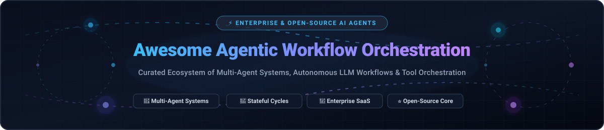

# ⚡ Awesome Agentic Workflow Orchestration 🤖

### A Curated Ecosystem of Multi-Agent Systems, Autonomous LLM Workflows & Enterprise AI Platforms

  <strong>Curated List of Enterprise SaaS Platforms &amp; Open-Source Agentic Orchestration Frameworks</strong> 
  <em>Focused on Multi-Agent Orchestration, Stateful LLM Graphs, Autonomous AI Agents, Tool-Using Workflows, and Durable Distributed Execution</em> 
  📅 <strong>Last updated: October 2026</strong>

---

## 🔍 Overview & Architecture

**Agentic Workflow Orchestration** represents the software paradigm where **multi-actor, autonomous AI agents** plan, reason, invoke external tools, maintain execution state across cyclical loops, and reliably execute end-to-end knowledge work and enterprise processes.

Unlike simple single-turn prompts or linear RAG pipelines, agentic orchestration engines solve:
* 🔄 **Stateful Multi-Turn Execution & Cycles:** Enabling agents to iterate, self-correct, and branch based on real-time feedback.
* 🤖 **Role-Playing & Multi-Agent Collaboration:** Decomposing complex tasks into specialized agents (e.g., Planner, Researcher, Coder, Critic).
* 🛠️ **Autonomous Tool & API Calling:** Enabling models to dynamically select and invoke APIs, databases, browsers, and code sandboxes.
* 🛡️ **Durable Execution & Human-in-the-Loop (HITL):** Checkpointing execution state, handling network timeouts gracefully, and requesting approvals before high-stakes mutations.

---

## 📑 Table of Contents

- [📊 Sector Overview & Market Dynamics](#-sector-overview--market-dynamics)
- [🏢 Enterprise SaaS Platforms](#-enterprise-saas-platforms)
- [⭐ Open-Source GitHub Frameworks](#-open-source-github-frameworks)
- [📈 Star History](#-star-history)
- [🤝 How to Contribute](#-how-to-contribute)
- [💖 Support](#-support)
- [⚠️ Disclaimer](#️-disclaimer)

---

## 📊 Sector Overview & Market Dynamics

The agentic AI and workflow orchestration market is estimated to reach approximately **$9B–$12B globally in 2026** (with multi-agent workflow orchestration software specifically accounting for **~$3.5B**), expanding at an extraordinary compound annual growth rate (**CAGR > 40%**). 

The industry displays a distinct **dual market dynamic**:
1. 🏛️ **Concentrated Hyperscaler & Infrastructure Layer:** Foundational intelligence models and baseline enterprise runtimes are heavily dominated by hyperscalers (Microsoft, Alphabet, Amazon) and established enterprise incumbents (Salesforce, ServiceNow) who bundle agent building into existing customer workflows.
2. 🌐 **Fragmented Application & Vertical Layer:** Hundreds of startups and specialized platforms compete across specialized business functions (customer experience, employee IT/HR support, browser automation, data pipeline orchestrations), creating a vibrant, competitive, and rapidly evolving landscape.

---

## 🏢 Enterprise SaaS Platforms

Below is a comparison of premier hosted agentic orchestration platforms, sorted in descending order by parent company valuation / market capitalization:

| Platform | Company Size (Market Cap / Valuation / Revenue) | Core Capabilities | Starting Pricing | Free Tier / Free Trial Limits |
| :--- | :--- | :--- | :--- | :--- |
| **[Microsoft Copilot Studio](https://www.microsoft.com/en-us/microsoft-copilot/microsoft-copilot-studio)** | ~$3.1T Market Cap (~$245B Ann. Revenue) | Low-code studio for building, testing, and deploying custom AI agents integrated with Microsoft 365, Power Platform, and enterprise graph data. | $200.00/month (prepaid capacity pack including 25,000 Copilot Credits; or pay-as-you-go via Azure) | 30-day free trial (extendable by 30 days, capped at 10 requests/min and 200 requests/hour; included usage for licensed M365 Copilot users) |
| **[Google Vertex AI Agents](https://cloud.google.com/vertex-ai)** | ~$2.1T Market Cap (~$350B Ann. Revenue) | Enterprise agent building, grounding, and orchestration within Vertex AI for autonomous multimodal apps and enterprise search. | $0 platform fee; pay-per-use starting at $1.50 per 1,000 search queries plus foundation model token consumption (Gemini) | 10,000 free search queries/month; plus $300 new customer cloud credits valid for 90 days across Google Cloud & Vertex AI |
| **[Amazon Bedrock Agents](https://aws.amazon.com/bedrock/agents/)** | ~$1.9T Market Cap (~$600B Ann. Revenue) | Fully managed AWS service for orchestrating autonomous agents that plan, call APIs/Lambda tools, and execute multi-step business logic. | Pay-as-you-go based on underlying FM token consumption (e.g., Anthropic Claude, Amazon Nova) and vector store infrastructure | No perpetual free tier; $200 promotional credit available for eligible new AWS accounts valid for 90 days |
| **[Salesforce Agentforce](https://www.salesforce.com/agentforce/)** | ~$280B Market Cap (~$38B Ann. Revenue) | Autonomous and assisted agentic orchestration layer embedded across Salesforce Sales, Service, Marketing, and Commerce clouds. | $2.00 per conversation, or $500 per 100,000 Flex Credits (~$0.10 per standard action) | Free allocation of 100,000–200,000 Flex Credits via Salesforce Foundations for Enterprise+ Edition customers; free unlimited Trailhead Developer Playgrounds |
| **[ServiceNow Now Assist](https://www.servicenow.com/products/now-assist.html)** | ~$180B Market Cap (~$11B Ann. Revenue) | Generative AI and agent orchestration embedded into the ServiceNow platform for IT, customer service, HR, and business workflows. | Enterprise quote-based uplift; typically adds 50%–60% uplift over standard licenses (~$100–$150+/user/month in Pro+ tiers with Assist bundles) | 30-day evaluation trial on sub-production instances via ServiceNow Store; promotional starter bundles (e.g., 150,000 Assists pool for POCs) |
| **[Cognigy](https://www.cognigy.com/)** | ~$7.5B (Acquired by NICE, parent revenue ~$2.7B) | Enterprise conversational AI platform for voice and chat agents with advanced dialogue management and agent copilot integrations. | Annual custom contracts starting at ~$40,000–$45,000/year (~60,000 conversations/year baseline package on cloud marketplaces) | No public self-serve free trial; sales-led proof-of-concept trial environments with custom payload and profile quota limits |
| **[Moveworks](https://www.moveworks.com/)** | ~$2.1B Valuation (~$100M+ ARR) | Enterprise AI assistant platform focused on employee support, IT service management, and cross-system workflow automation. | Annual headcount-based licensing starting at ~$90,000/year (typically $15–$45/employee/year for enterprise commitments; $150/employee/year on AWS marketplace) | No public free tier or free trial; evaluation is strictly via sales-led enterprise proof-of-concept demonstrations |
| **[Ada](https://www.ada.cx/)** | ~$1.2B Valuation (~$50M+ ARR) | Customer service AI agent platform specializing in automated support, brand-aligned conversations, and resolution handling. | Platform base fee + performance model; entry-level deployments start at ~$30,000–$40,000/year (~$1.00–$3.50 per automated resolution) | No self-serve free trial; enterprise pilots and sandbox proofs-of-concept provided through sales evaluation |
| **[Kore.ai](https://kore.ai/)** | ~$1.0B Valuation (~$60M+ ARR) | AI agent and virtual assistant platform for enterprise customer experience and employee experience automation. | Pay-as-you-go standard tier starting at $100 minimum prepaid purchase; full enterprise contracts start at ~$50,000/year | 14-day to 30-day free trial on select modules; $500 free credit allowance valid for 90 days; free developer tier capped at 5,000 requests/month (20 requests/minute) |
| **[Amelia](https://amelia.com/)** | ~$800M Market Cap (Acquired by SoundHound AI, revenue ~$85M) | Conversational AI and intelligent automation platform for customer service, healthcare, and enterprise process automation. | Enterprise custom quote; standalone voice tiers start at $249–$499/month, while full Amelia enterprise deployments start at ~$50,000+/year | No self-serve free trial; guided enterprise proof-of-concept (PoC) evaluation environments available upon sales qualification |

---

## ⭐ Open-Source GitHub Frameworks

The open-source ecosystem provides transparent, developer-controlled, and self-hosted primitives for building complex agent swarms and state machines. 

The list below is **sorted in descending order by GitHub Stars**:

1. **[n8n](https://github.com/n8n-io/n8n)**   
   Fair-code workflow automation platform with extensive AI agent nodes, native tool execution, and 400+ pre-built integrations for visual agent orchestration.

2. **[AutoGPT](https://github.com/Significant-Gravitas/AutoGPT)**   
   Pioneering autonomous AI agent toolkit and platform empowering agents to solve complex problems and execute multi-step goals independently.

3. **[Dify](https://github.com/langgenius/dify)**   
   Open-source LLM application development platform featuring visual multi-agent workflow orchestration, RAG pipelines, and model management.

4. **[Browser Use](https://github.com/browser-use/browser-use)**   
   Web automation library enabling AI agents to interact with websites and web applications autonomously via browser control.

5. **[MetaGPT](https://github.com/geekan/MetaGPT)**   
   Multi-agent meta programming framework that assigns distinct roles to LLMs (Product Manager, Architect, Engineer) to collaborate on end-to-end software development.

6. **[AutoGen](https://github.com/microsoft/autogen)**   
   Pioneering multi-agent conversational framework enabling complex collaborative workflows and customizable agent personas.

7. **[CrewAI](https://github.com/crewAIInc/crewAI)**   
   Intuitive framework for orchestrating role-playing autonomous AI agents and collaborative agent crews to automate complex task execution.

8. **[Flowise](https://github.com/FlowiseAI/Flowise)**   
   Drag-and-drop visual UI platform for building customized LLM flows, multi-agent orchestrations, and interactive AI agents with LangChain.

9. **[LlamaIndex](https://github.com/run-llama/llama_index)**   
   Leading data framework and event-driven workflow abstractions (`llama-index-core` Workflows) for context-augmented multi-agent LLM applications.

10. **[LangGraph](https://github.com/langchain-ai/langgraph)**   
    Low-level graph orchestration framework for building stateful, multi-actor LLM applications with cyclical flows, persistence, and human-in-the-loop control.

11. **[Semantic Kernel](https://github.com/microsoft/semantic-kernel)**   
    Enterprise-ready SDK that integrates LLMs with conventional programming languages (C#, Python, Java) with multi-agent orchestration and planner support.

12. **[Prefect](https://github.com/PrefectHQ/prefect)**   
    Resilient workflow orchestration engine supporting modern data and agentic pipelines with dynamic task runs, scheduling, and observability.

13. **[Temporal](https://github.com/temporalio/temporal)**   
    Durable execution system for building resilient, fault-tolerant, long-running agentic workflows and distributed systems with zero data loss.

14. **[CAMEL](https://github.com/camel-ai/camel)**   
    Communicative agent framework exploring autonomous multi-agent cooperation, cognitive architectures, and agent scaling laws.

15. **[Dagster](https://github.com/dagster-io/dagster)**   
    Data-aware orchestration platform for scheduling, monitoring, and executing LLM, agentic, and analytics pipelines as observable software assets.

---

## 📈 Star History

---

## 🤝 How to Contribute

Contributions are welcome! If you know of an enterprise SaaS platform or open-source agentic framework that should be included:

1. 🍴 **Fork** the repository.
2. 🌿 Create a descriptive branch: `git checkout -b feature/add-new-agent-platform`.
3. 📝 Update `README.md` following the established format:
   - For **SaaS**: Include accurate company size/valuation, concise capability summary, specific starting price, and exact free tier/trial limits.
   - For **Open-Source**: Include the repo name, social star badge linking to `/stargazers`, and a descriptive summary.
4. 🚀 Submit a **Pull Request** with clear context and official references.

---

## 💖 Support

Thank you for exploring and using this repository! If you find this curated list of agentic workflow orchestration platforms and frameworks helpful:

- ⭐ **Star this repository** to help others discover it!
- 🍴 **Fork and share** it with fellow AI engineers and automation architects.
- ☕ If you'd like to support continued curation and open-source contributions, feel free to **buy a coffee** via our [GitHub Sponsors Dashboard](https://github.com/sponsors/ishandutta2007)!

---

## ⚠️ Disclaimer

- This is a **community-curated** reference list — not an endorsement of any particular vendor or architecture.
- Agentic workflows can execute arbitrary code, call mutating APIs, and manage critical data. Ensure robust authentication, sandboxing, audit logging, and human-in-the-loop controls before running autonomous agents in production.
- All product names, logos, and brands are property of their respective owners.

---

  Built with ❤️ for AI engineers, autonomous agent architects, and open-source developers worldwide.

